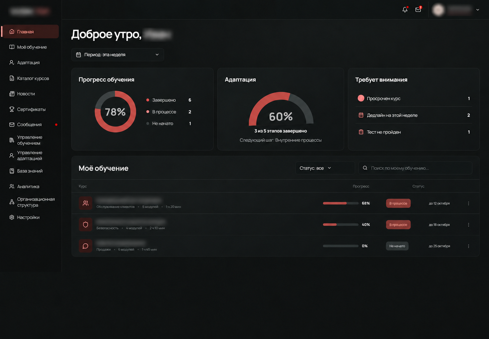
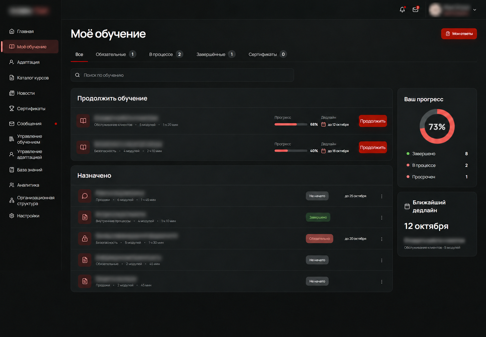
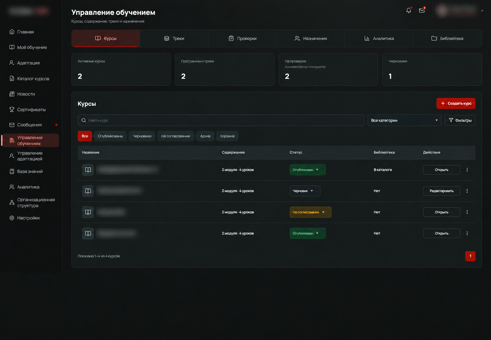
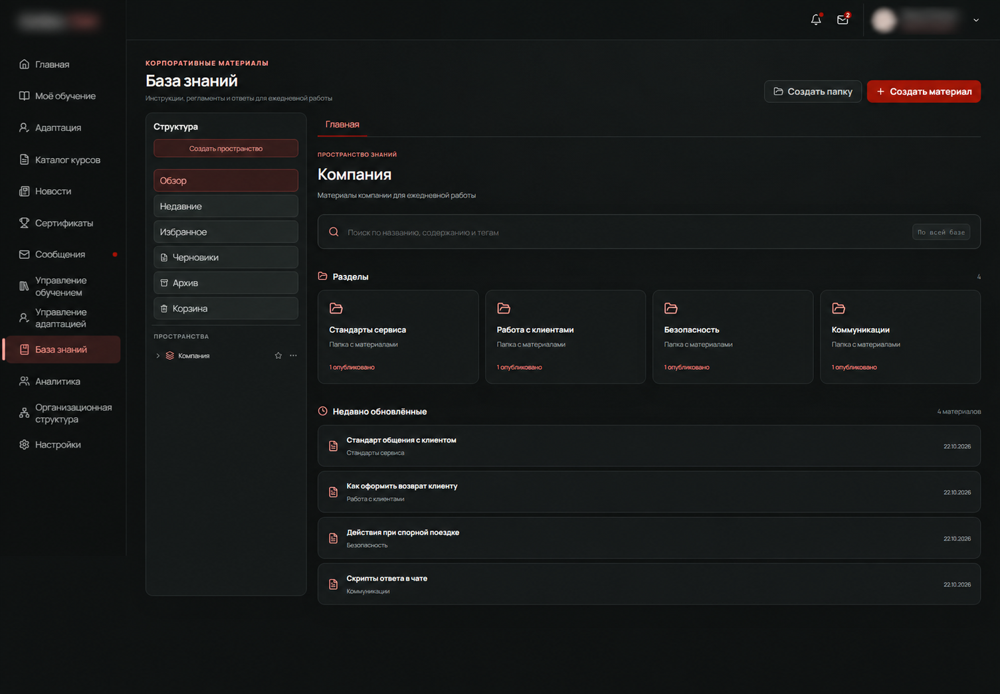

# LMS Platform — Portfolio Case Study

An anonymized case study of a full-featured learning management system built for internal corporate training. Client branding, personal data, course names, and proprietary details have been intentionally obscured.

## What I built

- Employee learning dashboard with progress, deadlines, and attention alerts
- Personal learning area with assigned, active, and completed courses
- Course management workspace with publishing and review statuses
- Knowledge base with folders, materials, drafts, favorites, and archive
- Adaptation workflows, certificates, messaging, analytics, and organization structure
- Responsive dark interface with reusable React components

## Technology

TypeScript, React, Vite, React Router, Node.js, PostgreSQL, REST API, Vitest, and Playwright.

## Screenshots

### Learning dashboard

### Personal learning area

### Course management

### Knowledge base

## Privacy

This repository contains only anonymized screenshots and a high-level project description. The production source code, infrastructure details, client identity, and real user data remain private.
